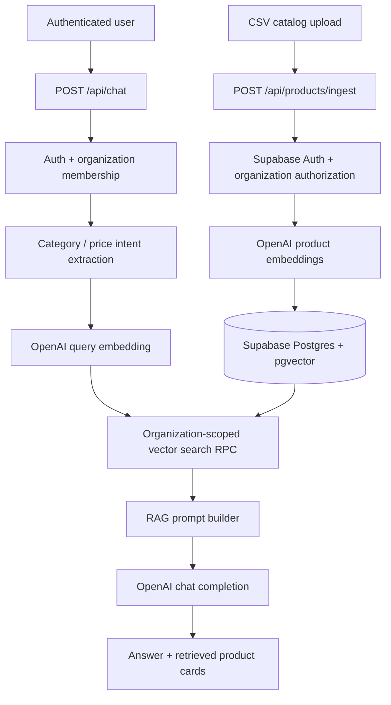

# Commerce V2 — AI-powered e-commerce product assistant

A portfolio MVP that ingests an e-commerce product catalog, builds OpenAI embeddings and answers natural-language shopping questions with **retrieved product evidence**. Built with Next.js, TypeScript, Supabase and pgvector.

**Status:** Working local demo; production deployment and public access not yet verified. Demo products and prices are illustrative, not a live store.

## Features

- Authenticated product catalog and organization-scoped access controls
- CSV upload with preview, validation, 10-item batches and inserted/skipped/unconfirmed counts (up to 50 products per upload)
- Product embedding generation with `text-embedding-3-small` (1536 dimensions)
- Semantic retrieval with SQL-level category and supported maximum-price filters
- RAG answer generation with product recommendations and matching product cards
- A basic `/chat-test` page for demonstration and manual verification

## Architecture

## Stack

Next.js **16.4.2** App Router, React, TypeScript, Tailwind CSS, Supabase Auth/SSR, PostgreSQL + pgvector, OpenAI API, Zod, Node test runner and ESLint.

## Demonstration

The test catalog contains **32 products** in six categories: 10 laptops, 8 smartphones, 4 tablets, 3 headphones, 3 smartwatches and 4 accessories. A manually verified query:

> Milyen laptopokat ajánlasz programozáshoz 1000 dollár alatt?

Returned five laptop recommendations, all priced at or below $1,000, with product cards and similarity scores. The demo does **not** guarantee robust handling of every natural-language category or currency expression.

## Local development

1. Install dependencies: `npm install`
2. Create `.env.local` locally; **never commit it**.
3. Configure the environment variables listed below and provision the matching Supabase schema, organization membership and search RPCs.
4. Start the dev server: `npm run dev`
5. Open `/login`, then `/chat-test` or the catalog dashboard.
6. Verify production compilation with `npm run build`.

### Required environment variables

| Variable | Purpose |
| --- | --- |
| `NEXT_PUBLIC_SUPABASE_URL` | Supabase project URL |
| `NEXT_PUBLIC_SUPABASE_ANON_KEY` | Supabase public/anon key |
| `OPENAI_API_KEY` | **Server-side only** OpenAI key |
| `COMMERCE_DEMO_ORGANIZATION_ID` | UUID of the configured demo organization |

A configured Supabase project with the necessary tables, RLS policies, authorized organization membership and vector-search RPCs is required. **The repository documentation alone does not provision the database**; RPC SQL migrations have not yet been committed. Do not treat this as a one-command turnkey deployment.

## Routes

| Route | Purpose |
| --- | --- |
| `/` | Dashboard / product catalog |
| `/login` | Login |
| `/chat-test` | RAG assistant test interface |
| `POST /api/chat` | Authenticated RAG query |
| `GET /api/products` | Catalog API |
| `POST /api/products/ingest` | Authorized product ingestion |

## Security and limitations

- Server-side API routes verify authenticated user access and organization membership; the retrieval RPCs independently enforce organization owner/admin membership and active-product restrictions.
- No service-role key is needed in the documented user-scoped ingestion path. Keep the OpenAI key server-side.
- SQL RPCs exist in the configured Supabase project but are not yet captured as version-controlled migrations.
- Production session refresh/cookie behavior, complete permissions review and a fresh dependency audit remain release checks.
- This is a **portfolio MVP**, not a production-ready multi-tenant SaaS or a finished public customer widget.

## Verification

- `npm run build` passed on Next.js 16.4.2.
- Category extraction unit tests: **8/8 passed**.
- Live manual CSV import: **32 inserted / 0 skipped / 0 unconfirmed**.
- Live manual category + price retrieval test passed.

## Project documentation

- [`docs/PROJECT_STATE.md`](docs/PROJECT_STATE.md) — implementation history and current release snapshot
- [`docs/AI_CORE.md`](docs/AI_CORE.md) — OpenAI modules, retrieval and RAG flow
- [`docs/PRODUCT_INGESTION.md`](docs/PRODUCT_INGESTION.md) — CSV, validation, embedding and persistence

## Roadmap

1. Commit documentation and publish repository on GitHub.
2. Validate Supabase Auth/session handling and deploy to Vercel.
3. Smoke-test deployed login, catalog and chat before adding the portfolio link.
4. Later: capture SQL RPCs in migrations and add retrieval regression tests.
