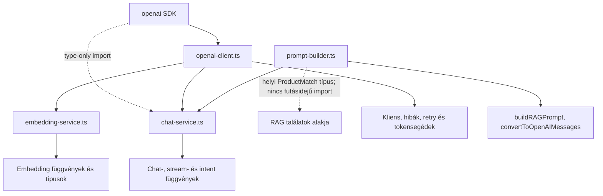
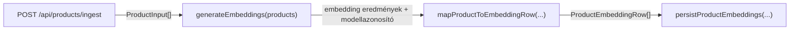
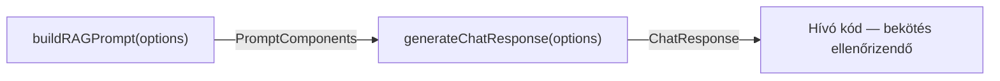

# AI core modulok

## Cél és hatókör

Ez a négy modul az OpenAI-kliens létrehozását, a szövegbeágyazások készítését, a prompt összeállítását és a chat-hívásokat kezeli. A dokumentáció a forráskódban megfigyelhető működést írja le.

Az `openai` SDK a modulok egyetlen közvetlen külső csomagfüggősége. A kliens a `OPENAI_API_KEY`, `OPENAI_MAX_RETRIES` és `OPENAI_TIMEOUT_MS` környezeti változókat használja; az embedding alapértelmezett modellje az `OPENAI_EMBEDDING_MODEL` változóból származhat. Az `openai-client.ts` importja nem igényel API-kulcsot. A kulcsot a `getOpenAIClient()` ellenőrzi, amikor először kérnek klienst. A `server-only` jelölés megakadályozza, hogy a Next.js kliensoldali kódja importálja ezt a modult. A migráció nem tartalmaz környezeti fájlt vagy hitelesítő adatot, és a validálás nem küld OpenAI-kérést.

Az eredeti `prompt-builder.ts` a `ProductMatch` típust a RAG-modulból importálta. Ez a típus a keresési modul Supabase-függősége mellett is önálló, így a migrált prompt builder a forrásban ellenőrzött, azonos mezőket tartalmazó helyi típust használ. A RAG-modul és a Supabase-kód nem került át.

## Modulok és fontos exportok

### `openai-client.ts`

Egyetlen OpenAI-klienspéldányt ad, egységes hibákat készít, újrapróbálkozást kezel, valamint tokenhasználatot és becsült költséget számol.

- `getOpenAIClient()` — konfigurált SDK-kliens; az első híváskor ellenőrzi a `OPENAI_API_KEY` értékét, és hiányzó vagy `your-openai-api-key-here` helyőrző kulcsnál az eredeti hibaüzenetet dobja. Az elkészült klienspéldányt újra felhasználja.
- `normalizeOpenAIError(error)` — OpenAI- és általános hibát `OpenAIError`, `RateLimitError`, `InvalidRequestError` vagy `AuthenticationError` típusra alakít.
- `withRetry(fn, options?)` — Promise-visszaadó művelet futtatása exponenciális késleltetéssel; az újrapróbálható hibákat ismétli. Az `options` mezői: `maxRetries`, `initialDelayMs`, `maxDelayMs`, `backoffMultiplier`.
- `extractTokenUsage(response)` — tokenhasználat kinyerése embedding- vagy chat-válaszból.
- `estimateCost(tokenUsage, model)` — a `text-embedding-3-small`, `gpt-4-turbo` és `gpt-4o` modellekhez költségbecslést ad; más modellnévre `0`-t ad.
- Exportált típusok: `RetryOptions`, `TokenUsage`; exportált hibaklasszisok: `OpenAIError`, `RateLimitError`, `InvalidRequestError`, `AuthenticationError`.

### `embedding-service.ts`

Termékszöveget készít, egy vagy több embeddinget kér, ellenőrzi a termékadatokat, és token-/költségbecslést ad.

- `prepareTextForEmbedding(product)` — név, leírás, opcionális kategória és ár összefűzése. Az ár kerekítve, `Ft` egységgel szerepel.
- `estimateTokenCount(text)` — karakterhossz alapján közelítő tokenszám.
- `generateEmbedding(text, organizationId?, model?)` — egy szöveg embeddingje. A `model` alapértéke az `OPENAI_EMBEDDING_MODEL`, ennek hiányában `text-embedding-3-small`. A bemenetet levágja, szóközeit normalizálja, majd kisbetűsíti.
- `generateEmbeddings(products, options?)` — termékeket kötegelve dolgoz fel; a `model`, `batchSize` és `(completed, total) => void` alakú `onProgress` callback opcionális.
- `generateSingleEmbedding(product, model?)` — egy termék embeddingje a termékszöveg-előkészítővel.
- `validateProduct(product)` és `validateProducts(products)` — egy terméket ellenőriznek, illetve a valid/hibás elemeket szétválasztják.
- `estimateEmbeddingCost(products)` — becsült tokenszámot és a `text-embedding-3-small` modellre számított költséget ad.
- `ProductInput` kötelező mezői a `product_id`, `product_name` és `product_description`; a `category`, `price` és `metadata` opcionális.
- Fő típusok: `ProductInput`, `EmbeddingResult`, `BatchEmbeddingResult`, `EmbeddingOptions`.

### `prompt-builder.ts`

RAG-beszélgetéshez rendszerpromptot, termékkontextust, előzményeket és aktuális kérdést rendez össze. A korábbi üzeneteket és szükség esetén a termékkontextust csonkolja; a tokenszám becslés, karakterhosszon alapul.

- `buildRAGPrompt(options)` — promptkomponenseket állít elő a kötelező `query`, `conversation_context` és `product_matches` értékekből. A `max_tokens`, `organization_name` és `custom_instructions` opcionális.
- `convertToOpenAIMessages(components)` — a komponenseket OpenAI `system`/`user`/`assistant` üzenetekké alakítja.
- A `ConversationContext` beszélgetés- és szervezetazonosítót, opcionális látogatói metaadatot, valamint előzményüzeneteket tartalmaz.
- Fő típusok: `ChatMessage`, `ConversationContext`, `PromptComponents`, `PromptBuilderOptions`.

### `chat-service.ts`

Promptkomponensekből normál vagy streaming chatválaszt kér; a normál választ tokenekkel, költségbecsléssel és válaszmetaadatokkal egészíti ki. Külön függvénye van szándék- és hangulatelemzésre.

- `generateChatResponse(options)` — teljes chatválaszt kér; az `options` mezői: `prompt_components`, opcionális `model`, `temperature`, `max_tokens`, `stream`, valamint kötelező `organization_id`.
- `generateChatResponseStream(options)` — `AsyncGenerator<ChatStreamChunk>` streamet ad; a streamelt kimenet tokenszáma becslés.
- `analyzeMessageIntent(message, organizationId)` — JSON-ként kért szándékot, hangulatot, bizonyosságot és leadjeleket ad vissza; hívási vagy JSON-feldolgozási hiba esetén alapértékeket ad.
- Fő típusok: `ChatResponse`, `ChatStreamChunk`, `ChatServiceOptions`.

A normál `generateChatResponse` nem streamelt SDK-választ vár; ha a `stream` opció `true`, a válasz feldolgozása hibával leáll. Streaminghez a külön `generateChatResponseStream` függvény szolgál.

## Import- és exportkapcsolatok

Az ábra a négy AI core modul közötti importkapcsolatokat mutatja, nem a teljes alkalmazást. Az embedding szolgáltatást időközben már meghívja az ingestion API; a chat/RAG út végponti bekötése ebből a dokumentumból nem igazolható.

## Példa: embedding készítése

1. A hívó egy `ProductInput` objektumot ad a `generateSingleEmbedding` függvénynek, vagy több terméket a `generateEmbeddings` függvénynek.
2. A termékes út a `prepareTextForEmbedding` függvénnyel összefűzi a termék nevét és leírását, majd ha vannak, hozzáadja a kategóriát és az árat.
3. A köteges út a terméklistát `batchSize` méretű részekre osztja. Minden rész szövegét egy embeddings-kéréssel küldi el; a `withRetry` az újrapróbálható hibákat kezeli.
4. A szolgáltatás a válasz embeddingjeit a termékazonosítókkal és a szöveggel párosítja, tokenhasználatot összegez, opcionális progress callbacket hív, majd eredményt, költségbecslést és időtartamot ad vissza.
5. A `generateEmbedding` külön, szabad szöveges út: tisztítja és kisbetűsíti a szöveget, majd egy embeddinget kér. Ez a függvény naplózza a használatot, de csak a vektort adja vissza.

## Két rövid példa: ki hív kit, mit ad vissza?

### A) Termékből embedding

- `prepareTextForEmbedding(product)` → **szöveg**, amelyet az embedding szolgáltatás használ fel.
- `generateEmbeddings(products)` → **köteges embedding-eredmény**, benne a termékekhez tartozó vektorokkal és modellinformációval; ezt a route dolgozza tovább.
- `mapProductToEmbeddingRow(...)` → **egy adatbázis-sor**, amelyet a route összegyűjt és átad a persistence függvénynek.

### B) Chat-válasz — modulok közötti kapcsolat

A `generateChatResponse()` a promptkomponenseket a `convertToOpenAIMessages()` segítségével SDK-üzenetekké alakítja, majd chatválaszt ad vissza. **Ez modul-szintű magyarázat, nem állítás arról, hogy már működik a teljes RAG felület.**

## Hibák terjedése

- Az `openai-client.ts` API-kulcs nélkül is importálható; a `getOpenAIClient()` dob hibát, ha a kulcs hiányzik vagy a helyőrző érték. API-hibákat a `normalizeOpenAIError` alakítja; a `withRetry` csak újrapróbálható hibákat ismétel, majd az utolsó normalizált hibát dobja tovább.
- A `generateEmbedding` naplózza a hibát, majd új `Error` objektummal, kiegészített üzenettel dobja tovább. A köteges és az egytermékes embedding-függvények nem csomagolják újra a `withRetry` hibáját.
- A `buildRAGPrompt` a belső hibát naplózza és `Prompt building failed` üzenettel dob új hibát.
- A `generateChatResponse` és a `generateChatResponseStream` naplózza, majd saját, kiegészített üzenettel dobja tovább a hibát. A normál chat saját retry-függvényt használ; a stream és az intent elemzés közvetlen SDK-hívást végez.
- Az `analyzeMessageIntent` hívási vagy JSON-parszolási hiba esetén nem dob tovább: `general_question`, `neutral`, `0.5` és üres `lead_signals` értéket ad.

## Miért külön modulok?

- A kliensmodul egy helyen tartja az SDK-konfigurációt, a közös hibamodelleket és az embeddingekhez használt retry-/tokensegédeket.
- Az embedding szolgáltatás a termékszöveg előkészítését, kötegelését és embedding-válaszok alakítását választja el a kliens inicializálásától.
- A prompt builder a kontextus és a tokenkeret összeállításáért felel; nem hívja az OpenAI SDK-t.
- A chat szolgáltatás a promptkonverziót és a chat API-hívásokat kezeli, ezért önállóan használhatja a chathez szükséges retry- és költséglogikát.

## Tervezett viselkedés (nem implementált)

A négy modul önmagában nem bizonyítja a teljes RAG/termékkeresési UI-integrációt. Az embedding út viszont már része a `POST /api/products/ingest` folyamatnak. A chat- és promptfüggvények teljes végponti bekötését a következő MVP-szakaszban a tényleges kódból kell ellenőrizni.

## Interview explanation

The AI core has four separate modules. One creates the OpenAI client and handles common errors. One prepares text and creates embeddings. One builds prompts from a question, product information, and chat history. The chat module sends messages and returns normal or streaming answers. Keeping these tasks separate makes each part easier to understand and test. The embedding service is now called by the product ingestion API; the chat/RAG integration still needs separate verification.

---

## Current end-to-end AI retrieval (2026-10-31)

> This section updates the earlier migration-era statements above. The four original AI core modules remain relevant, but RAG and chat are **now integrated**; earlier notes that the integration is not implemented are historical.

```mermaid
flowchart LR
  Q["User question /chat-test"] --> API["POST /api/chat"]
  API --> Auth["Supabase Auth + org membership"]
  Auth --> Filters["Price and category extractors"]
  Filters --> Embed["OpenAI query embedding 1536D"]
  Embed --> RPC["Supabase pgvector RPC with SQL filters"]
  RPC --> Matches["Product matches"]
  Matches --> Prompt["buildRAGPrompt"]
  Prompt --> Chat["generateChatResponse"]
  Chat --> UI["AI response + product cards"]
```

- `lib/ai/rag-service.ts`: `performVectorSearch` generates a query embedding and invokes one of three Supabase RPCs: baseline, price-filtered, or category-aware (which also accepts an optional price limit). Returns product matches and embedding/search timings.
- `lib/ai/extract-price-filter.ts`: deterministic parsing of supported maximum-price expressions; not a general natural-language currency parser.
- `lib/ai/extract-category-filter.ts`: deterministic keyword-based mapping to the six demo categories. Single-category, limited inflection and ambiguity coverage by design.
- `app/api/chat/route.ts`: authenticated user and organization-membership checks, filter extraction, retrieval, prompt building and OpenAI chat generation.
- `lib/ai/catalog-fallback.ts`: limited general-catalog fallback when there is no semantic match and no price filter, for recognized broad browsing questions. Fallback product cards are identified separately in the test UI.
- `app/chat-test/page.tsx`: working manual demonstration interface, **not** a production-hardened customer chat widget.

**Observed live test:** “Milyen laptopokat ajánlasz programozáshoz 1000 dollár alatt?” produced five laptop matches priced $649–$999; unrelated tablets and phones were absent. This is one successful integration scenario, not exhaustive coverage.

**Verified checks:** 8/8 category-extractor unit tests; TypeScript and ESLint checks; successful Next.js 16.4.2 production build. SQL RPC definitions exist in live Supabase but are not yet represented by version-controlled migrations. Production deployment and session behavior remain unverified.

### Updated interview explanation

The app embeds product descriptions into a 1536-dimensional vector store. For each user question, the backend checks authorization, extracts supported price and category constraints, embeds the query, and runs a pgvector similarity search with filters applied in SQL. Retrieved product data grounds the OpenAI-generated answer and is also shown as product cards. The architecture separates ingestion, retrieval, prompting and generation.
