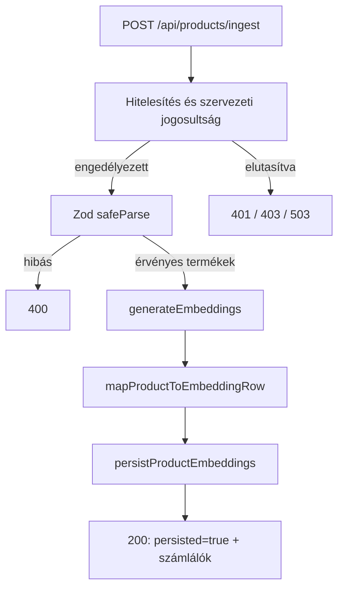
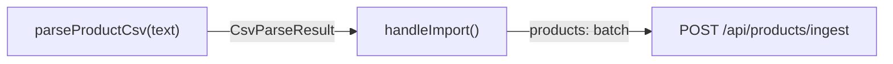
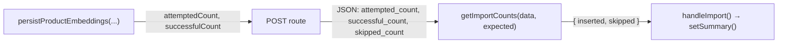
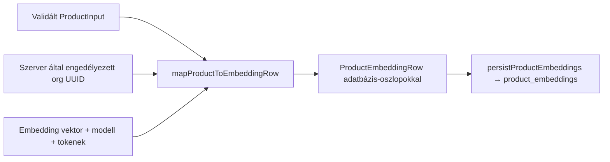
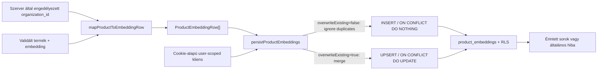
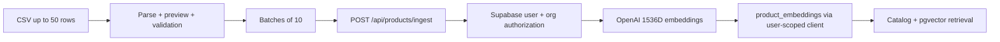

# Product ingestion — validálás, embedding és mentés

## Mire való ez a réteg?

A `lib/validations/product-ingestion.ts` Zod-sémái ellenőrzik a termékadatok és a kötegkérés alakját. Sikeres validáláskor Zod által következtetett TypeScript-típusok állnak rendelkezésre. A séma nem tartalmaz `organization_id` mezőt.

Ez a réteg **adatvalidálás**, nem jogosultság-ellenőrzés: megállapítja, hogy a bemenet megfelel-e a várt formátumnak, de nem azonosítja a felhasználót, és nem ellenőrzi, hogy hozzáfér-e egy szervezethez. Az ingestion route előbb hitelesít és jogosultságot ellenőriz, és csak ezután validálja a termékadatokat.

## Szerveroldali hitelesítés és szervezeti jogosultság

A `lib/supabase/server.ts` `server-only` modulként adja a `createUserSupabaseClient()` függvényt. A kliens csak a függvény meghívásakor olvassa a `NEXT_PUBLIC_SUPABASE_URL` értékét és a `NEXT_PUBLIC_SUPABASE_PUBLISHABLE_KEY` vagy `NEXT_PUBLIC_SUPABASE_ANON_KEY` kulcsot, majd a Next.js 16 aszinkron `cookies()` API-jával cookie-alapú SSR-klienst készít. A helper nem hoz létre klienst importkor, és nem használ service-role kulcsot. A kliensen a `auth.getUser()` ellenőrzi az aktuális felhasználót.

A `lib/supabase/organization-authorization.ts` `authorizeOrganizationIngestion(userId, organizationId)` függvénye maga hozza létre a fenti user-scoped klienst, így nem fogad tetszőleges (esetleg service-role) klienst. Ezzel kéri le az `organization_members.role` mezőt, mind a felhasználóra, mind a szervezetre szűrve. `owner` és `admin` engedélyezett; tagság hiányában `not_member`, `member` szerepkörnél `insufficient_role`, lekérdezési vagy klienslétrehozási hibánál `database_error`, ismeretlen szerepkörnél `unexpected_role` az eredmény. Hiba soha nem eredményez engedélyezést.

### User-scoped és service-role kliens

A user-scoped kliens a publikus publishable/anon kulcsot és a kérés cookie-jait használja. A lekérdezés a bejelentkezett felhasználó jogosultságaival, az RLS hatálya alatt fut. Az authorization helper ezt a klienst hozza létre; service-role kulccsal működő klienst nem használ.

A service-role kliens megkerüli az RLS-t. Nem alkalmas felhasználói hitelesítésre vagy tagság ellenőrzésére, és nem kerülhet kliensoldalra. Az ingestion route nem használ service-role klienst. Sikeres jogosultság-ellenőrzés és validálás után embeddinget készít, majd user-scoped klienssel ment.

```mermaid
sequenceDiagram
  actor Client as Hívó
  participant Route as POST /api/products/ingest
  participant Cookies as Next.js cookies()
  participant Auth as Supabase Auth
  participant Guard as authorizeOrganizationIngestion
  participant DB as organization_members (RLS)
  participant Validation as productIngestionRequestSchema

  Client->>Route: POST termékköteg
  Route->>Cookies: createUserSupabaseClient()
  Cookies-->>Route: cookie-alapú user-scoped kliens
  Route->>Auth: auth.getUser()
  Auth-->>Route: user vagy nincs hitelesített user
  Note over Route: Nincs user: 401
  Route->>Route: COMMERCE_DEMO_ORGANIZATION_ID UUID ellenőrzése
  Note over Route: Hiányzó vagy hibás konfiguráció: 503
  Route->>Guard: hitelesített user.id + szerveroldali organizationId
  Guard->>Cookies: createUserSupabaseClient()
  Cookies-->>Guard: cookie-alapú user-scoped kliens
  Guard->>DB: role lekérdezése user_id + organization_id alapján
  DB-->>Guard: szerepkör vagy query hiba
  Guard-->>Route: explicit engedélyezési eredmény
  Note over Route: Nincs tagság / nem engedélyezett szerep: 403; query hiba: 503
  Route->>Route: request.json()
  Route->>Validation: safeParse(body)
  Note over Route: Hibás JSON vagy termékadat: 400
  Route->>Route: generateEmbeddings + mapProductToEmbeddingRow
  Route->>Route: persistProductEmbeddings
  Route-->>Client: 200 persisted=true, ellenőrzött számlálók
```

## Fájlok felelőssége

- `lib/validations/product-ingestion.ts` — termék- és kötegkérési sémák, valamint az azokból származó `ProductInput` és `ProductIngestionRequest` típusok.
- `tests/validations/product-ingestion.test.mjs` — Node beépített tesztfuttatójával ellenőrzi az érvényes és hibás bemeneteket, a korlátokat és az alapértékeket.
- `lib/products/product-embedding-mapper.ts` — validált termék- és embeddingadatból adatbázis-oszlopokat követő sort készít, de nem persistál.
- `tests/products/product-embedding-mapper.test.mjs` — a leképezést, a vektor és szervezet UUID ellenőrzését, valamint a DB-defaultokat teszteli.
- `lib/supabase/server.ts` — lusta, cookie-alapú, szerveroldali user-scoped Supabase-kliens.
- `lib/supabase/organization-authorization.ts` — tagság- és szerepkörellenőrzés explicit eredmény-unióval; csak `owner` és `admin` engedélyezett.
- `tests/supabase/organization-authorization.test.mjs` — mockolt Supabase-lekérdezésekkel ellenőrzi az engedélyezett és tiltott eseteket.
- `app/api/products/ingest/route.ts` — hitelesít, jogosultságot és adatot validál, embeddinget generál, DB-sorokat állít elő, persistál és HTTP-választ ad.
- `tests/api/products-ingest.test.mjs` — mockokkal ellenőrzi a route HTTP-szerződését és a body feldolgozásának sorrendjét.
- `docs/architecture/PRODUCT_INGESTION.md` — dokumentálja a validálási és API-folyamatot.

## Adatfolyam

A megvalósított API a validálás után embeddinget készít és ment. A következő ábra szándékosan csak a fő lépéseket mutatja.



A mentés vagy embedding hibája nem számít sikeres importnak; a pontos hibaválaszokat a route kódja határozza meg.

## Függvények közötti adatátadás — két rövid szakasz

**1. CSV → API:** `handleFile()` beolvassa a fájlt; `parseProductCsv(text)` egy `CsvParseResult` objektumot ad vissza. A `handleImport()` ebből a `validProducts` tömböt 10-es kötegekben küldi a `POST /api/products/ingest` végpontra.



**2. API → UI:** a route a `generateEmbeddings(products)` eredményét a `mapProductToEmbeddingRow(...)` függvénnyel DB-sorokká alakítja. A `persistProductEmbeddings(...)` visszaadja az `attemptedCount` és — ha igazolt — `successfulCount` értékeket. A route ezekből HTTP JSON-t készít; a UI `getImportCounts(data, batch.length)` függvénye ellenőrzi és `{ inserted, skipped }` formában adja vissza a `handleImport()` számára.



Példa `overwrite_existing: false` mellett: 3 már létező termék → `attempted_count: 3`, `successful_count: 0`, `skipped_count: 3`. A `skipped` **nem hiba**. Hálózati vagy nem ellenőrizhető válasz esetén a UI az érintett köteget `unconfirmed` kategóriába sorolja.

## API-kérés és HTTP-válaszok

Az endpoint `POST /api/products/ingest`. A request body `userId` vagy `organization_id` mezője nem jogosultsági forrás. A szervezetet a szerveren beállított `COMMERCE_DEMO_ORGANIZATION_ID` változó adja; ennek UUID-nak kell lennie.

- `200`: `status: "persisted"`, `persisted: true`, `attempted_count`; ha a DB visszaadja a tényleges darabszámot, `successful_count` is. `overwrite_existing: false` esetén ellenőrzött számláló mellett `skipped_count = attempted_count - successful_count`.
- `400`: hibás JSON vagy érvénytelen termékadat. A válasz validációs útvonalakat és üzeneteket tartalmaz, termék-payloadot nem.
- `401`: nincs hitelesített felhasználó.
- `403`: nincs szervezeti tagság, vagy a szerepkör nem `owner`/`admin`.
- `503`: a hitelesítés nem érhető el, hiányzik/hibás a demo-szervezet konfigurációja, vagy hibázott a jogosultság-lekérdezés. Az adatbázishiba részletei nem kerülnek vissza.

A route csak sikeres jogosultság-ellenőrzés után dolgozza fel a kérés törzsét. A `200` a mentési művelet sikerét jelzi; duplikátum kihagyásakor nem feltétlenül keletkezik új rekord.

## Product embedding mapper

A `lib/products/product-embedding-mapper.ts` tiszta leképezőfüggvénye a szerver által már engedélyezett szervezet UUID-ját, egy validált `ProductInput` értéket, az embedding vektort, a modellazonosítót és az opcionális token-számot alakítja adatbázis-beszúráshoz használható `ProductEmbeddingRow` objektummá. Az `organization_id` külön paraméter, nem származik termékadatból vagy metadata-ból; a mapper UUID-formátumot ellenőriz, de jogosultságot nem.

A termék mezői az adatbázis oszlopneveire képződnek le. A nem megadott kategória, ár és URL mezők SQL `NULL`-ként szerepelnek. A hiányzó pénznem és metadata nincs hozzáadva a beszúrási objektumhoz, így a tábla alapértékei (`USD`, illetve `{}`) érvényesülhetnek. A hiányzó token-szám `NULL`. A vektornak pontosan 1536 véges számot kell tartalmaznia. Az `id`, `created_at`, `updated_at` és `is_active` mezőket a mapper nem állítja elő, ezeket az adatbázis alapértékeire bízza.

### Embedding model contract

Az embedding szolgáltatás kizárólag a `text-embedding-3-small` modellt engedélyezi, 1536 dimenziós kimenettel. A `resolveEmbeddingModel()` feloldja a modell nevét; a `generateEmbeddings()` eredményei tartalmazzák a modellazonosítót. Nem megfelelő modellbeállítást már a kérés előtt elutasít, a kapott vektoroknál pedig ellenőrzi az 1536 véges számot. A mapper a tényleges embedding-eredményből kapja a modellazonosítót.



A mapper csak adatot alakít át és ellenőriz; **nem persistál**, nem hív Supabase-t vagy OpenAI-t.

## Product embedding persistence

A `lib/products/product-persistence.ts` szerveroldali, `server-only` modulja a `createUserSupabaseClient()` cookie-alapú user-scoped kliensével ír a `product_embeddings` táblába. Service-role klienst nem készít. A függvény fogadja az engedélyezett szervezet UUID-ját, a mapper által előállított sorokat és az `overwriteExisting` kapcsolót. A beszúrás előtt elutasítja az üres köteget, ismétlődő `product_id`-kat, hibás azonosítókat és más szervezethez tartozó sorokat; minden elutasítás a Supabase-hívás előtt történik.

- `overwriteExisting: false`: az egyedi kulcs `organization_id,product_id`; a kliens `ignoreDuplicates: true` opciója az `ON CONFLICT DO NOTHING` viselkedésnek felel meg. Meglévő rekordot nem frissít.
- `overwriteExisting: true`: ugyanezen kulccsal `ON CONFLICT DO UPDATE` upsert történik.
- Mindkét ágnál `defaultToNull: false` van beállítva. A kihagyott `product_currency` és `metadata` beszúráskor a DB-defaultot kapja (`USD`, `{}`); konfliktusos upsertnél ezek a kihagyott mezők megőrzik a meglévő értéküket. A mapper által `null`-ként megadott kategória, ár, URL és token mezők overwrite esetén viszont törlik a meglévő értéket. Az `is_active` nincs a mapper sorában: új sornál DB-default (`true`), frissítésnél a meglévő állapot marad.
- A kliens `.select("product_id")` visszakérdezésével a sikeres beszúrt/frissített sorok számolható. A függvény `successfulCount` értéket csak akkor ad, ha a válaszban valóban tömb érkezik; DB-hibánál csak általános `database_error` státuszt ad vissza, a nyers hiba részleteit nem.



A persistence helpert az ingestion API-route már meghívja. A CSV UI-ból végrehajtott háromtermékes ismételt import sikeresen 0 beszúrást, 3 kihagyást és 0 nem igazolt elemet mutatott (COM-009C).

Az adatbázis-séma, egyedi kulcs, `VECTOR(1536)`, RLS és jogosultságok a megadott élő, read-only ellenőrzés alapján tekintendők igazoltnak; ebben a feladatban nem történt új Supabase-kapcsolat.

## Ellenőrzött szabályok

- `product_id`: 1–255 karakter.
- `product_name`: 2–500 karakter.
- `product_description`: 10–5000 karakter.
- `category`: opcionális, legfeljebb 100 karakter.
- `price`: opcionális, véges és nemnegatív szám.
- `currency`: opcionális, pontosan három nagybetű.
- `product_url` és `product_image_url`: opcionális, érvényes HTTP- vagy HTTPS-URL.
- `metadata`: opcionális objektum, amely JSON-értékeket tartalmazhat rekurzívan (szöveg, véges szám, logikai érték, null, tömb vagy objektum).
- `products`: 1–100 termék.
- `batch_size`: egész szám 1–20 között, alapértéke 10.
- `overwrite_existing`: logikai érték, alapértéke `false`.

Az adatbázis oszlopaihoz és hosszkorlátaihoz igazodó szabályok a projekt által megadott sémakontextuson alapulnak; az élő adatbázisban ezek még nincsenek ellenőrizve.

## Megvalósult CSV-import (COM-009 / COM-009C)

- `app/csv-product-upload.tsx`: fájlválasztás, validációs előnézet, kötegelt import, összesítés.
- `lib/products/parse-product-csv.ts`: CSV-feldolgozás; a UI legfeljebb 50 terméket enged feltölteni.
- COM-009 commit: `9498ba3`; duplikátumszámlálás javítása: `60f6e4b`.
- Ellenőrzés: TypeScript, ESLint és production build sikeres; a 3 már létező termék ismételt importja: 0 inserted / 3 skipped / 0 unconfirmed.
- A két helyi, nem követett fájl (`lib/products/parse-product-csv.test.mjs`, `test-products.csv`) nem része a commitnak.

## Rövid magyarázat állásinterjúhoz

Az API cookie-alapú Supabase-munkamenetből azonosítja a felhasználót, majd ellenőrzi a szervezeti szerepkörét. Csak owner és admin jogosult importálni. Ezután validálja a termékeket, embeddingeket készít és adatbázisba ment; a válaszban a ténylegesen mentett és kihagyott elemek száma is megjelenhet.


---

## Current ingestion/demo catalog update (2026-10-31)

> The older three-product and 39-product counts above are historical test observations, not the current catalog.

- Replaced old demo inventory with a clean **32-product** test catalog. The prior demo rows for the selected organization were deliberately deleted before reimport.
- CSV preview: **32 valid, 0 invalid**. Import: **32 inserted, 0 skipped, 0 failed/unconfirmed**.
- SQL category check for active products: **Laptops 10; Smartphones 8; Tablets 4; Headphones 3; Smartwatches 3; Accessories 4**. No missing categories in that verified count.
- The imported CSV used columns `product_id,product_name,product_description,category,price,currency,product_url,product_image_url`; fictional demo pricing is in USD.
- Existing `POST /api/products/ingest` pipeline, 10-item CSV batches, duplicate accounting, organization checks and Supabase persistence remain in place.
- These clean categories now support the separate category-aware retrieval SQL RPC, described in `docs/AI_CORE.md` and the project README. Ingestion itself does **not** perform the query-time category filtering.



**Release boundary:** Local build passed. Production Auth/cookie behavior, deployed import workflow and SQL migration reproducibility still need verification. Do not commit `.env.local` or any real customer data. The two existing untracked local fixtures are intentionally left untouched.
