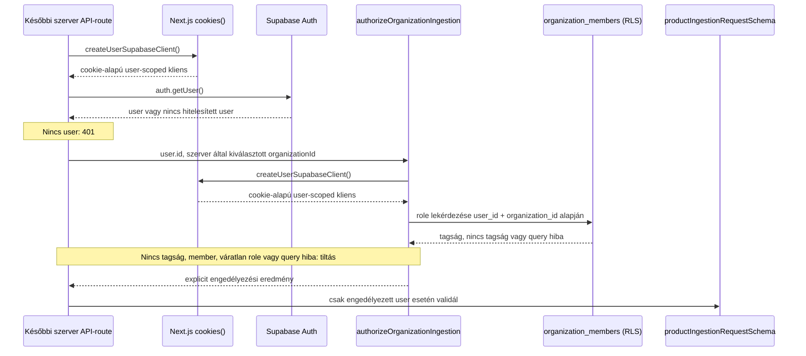
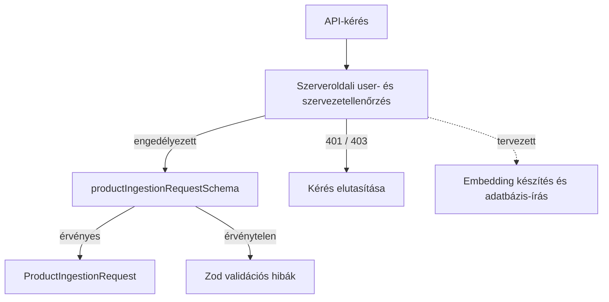

# Product ingestion — validálási alap

## Mire való ez a réteg?

A `lib/validations/product-ingestion.ts` Zod-sémái ellenőrzik a termékadatok és a kötegkérés alakját. Sikeres validáláskor Zod által következtetett TypeScript-típusok állnak rendelkezésre. A séma nem tartalmaz `organization_id` mezőt.

Ez a réteg **adatvalidálás**, nem jogosultság-ellenőrzés: megállapítja, hogy a bemenet megfelel-e a várt formátumnak, de nem azonosítja a felhasználót, és nem ellenőrzi, hogy hozzáfér-e egy szervezethez. A szerveroldali auth- és authorization-helperek elkészültek; a későbbi API-route feladata lesz ezek meghívása a termékadat validálása előtt.

## Szerveroldali hitelesítés és szervezeti jogosultság

A `lib/supabase/server.ts` `server-only` modulként adja a `createUserSupabaseClient()` függvényt. A kliens csak a függvény meghívásakor olvassa a `NEXT_PUBLIC_SUPABASE_URL` értékét és a `NEXT_PUBLIC_SUPABASE_PUBLISHABLE_KEY` vagy `NEXT_PUBLIC_SUPABASE_ANON_KEY` kulcsot, majd a Next.js 16 aszinkron `cookies()` API-jával cookie-alapú SSR-klienst készít. A helper nem hoz létre klienst importkor, és nem használ service-role kulcsot. A kliensen a `auth.getUser()` ellenőrzi az aktuális felhasználót.

A `lib/supabase/organization-authorization.ts` `authorizeOrganizationIngestion(userId, organizationId)` függvénye maga hozza létre a fenti user-scoped klienst, így nem fogad tetszőleges (esetleg service-role) klienst. Ezzel kéri le az `organization_members.role` mezőt, mind a felhasználóra, mind a szervezetre szűrve. `owner` és `admin` engedélyezett; tagság hiányában `not_member`, `member` szerepkörnél `insufficient_role`, lekérdezési vagy klienslétrehozási hibánál `database_error`, ismeretlen szerepkörnél `unexpected_role` az eredmény. Hiba soha nem eredményez engedélyezést.

### User-scoped és service-role kliens

A user-scoped kliens a publikus publishable/anon kulcsot és a kérés cookie-jait használja. A lekérdezés a bejelentkezett felhasználó jogosultságaival, az RLS hatálya alatt fut. Az authorization helper ezt a klienst hozza létre; service-role kulccsal működő klienst nem használ.

A service-role kliens megkerüli az RLS-t. Nem alkalmas felhasználói hitelesítésre vagy tagság ellenőrzésére, és nem kerülhet kliensoldalra. Ebben a lépésben nincs service-role kliens, API-route vagy adatbázis-írás.

## Fájlok felelőssége

- `lib/validations/product-ingestion.ts` — termék- és kötegkérési sémák, valamint az azokból származó `ProductInput` és `ProductIngestionRequest` típusok.
- `tests/validations/product-ingestion.test.mjs` — Node beépített tesztfuttatójával ellenőrzi az érvényes és hibás bemeneteket, a korlátokat és az alapértékeket.
- `lib/supabase/server.ts` — lusta, cookie-alapú, szerveroldali user-scoped Supabase-kliens.
- `lib/supabase/organization-authorization.ts` — tagság- és szerepkörellenőrzés explicit eredmény-unióval; csak `owner` és `admin` engedélyezett.
- `tests/supabase/organization-authorization.test.mjs` — mockolt Supabase-lekérdezésekkel ellenőrzi az engedélyezett és tiltott eseteket.
- `docs/architecture/PRODUCT_INGESTION.md` — a validálási réteg hatókörét és későbbi helyét dokumentálja.

## Adatfolyam

Az ábra a későbbi API-route tervezett kérésfolyamát mutatja: az auth- és authorization-helperek már megvannak, de a route és a DB-ingestion még nem implementált.

Az ábra az authorizationt és validálást összekapcsoló későbbi route-tervet mutatja. A szekvenciaábra a meglévő auth- és authorization-helperek szerződését szemlélteti; a route-integráció még nincs implementálva.

## Ellenőrzött szabályok

- `product_id`: 1–255 karakter.
- `product_name`: 2–500 karakter.
- `product_description`: 10–5000 karakter.
- `category`: opcionális, legfeljebb 100 karakter.
- `price`: opcionális, véges és nemnegatív szám.
- `currency`: opcionális, pontosan három nagybetű.
- `product_url` és `product_image_url`: opcionális, érvényes HTTP- vagy HTTPS-URL.
- `metadata`: opcionális objektum, amely JSON-értékeket tartalmazhat rekurzívan (szöveg, véges szám, logikai érték, null, tömb vagy objektum).
- `products`: 1–100 termék.
- `batch_size`: egész szám 1–20 között, alapértéke 10.
- `overwrite_existing`: logikai érték, alapértéke `false`.

Az adatbázis oszlopaihoz és hosszkorlátaihoz igazodó szabályok a projekt által megadott sémakontextuson alapulnak; az élő adatbázisban ezek még nincsenek ellenőrizve.

## Interview explanation

The validation layer checks product data and batch limits. A server-only helper reads the user's Supabase session from cookies. Another helper checks the user's organization role. Only owners and admins are allowed. Validation and authorization are different steps. A future API route must authenticate and authorize before it validates the product batch. No API route or database write is included yet.
