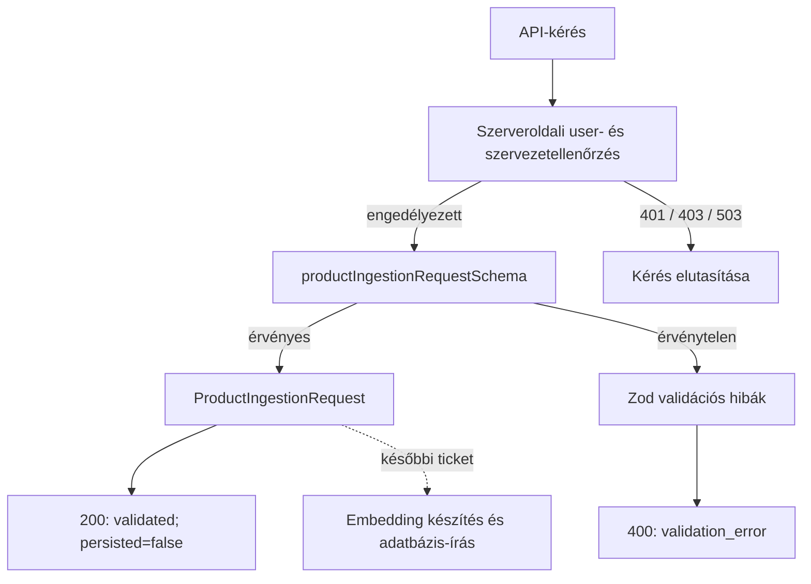
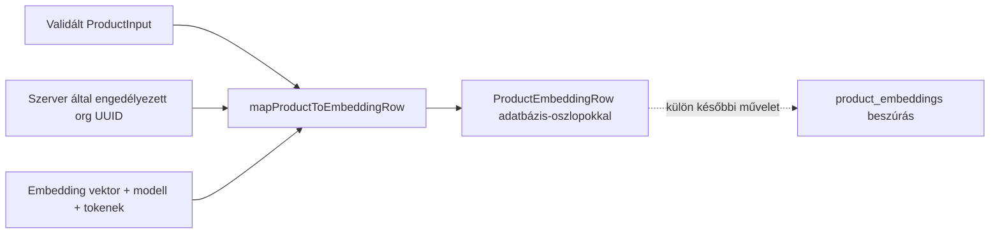

# Product ingestion — validálási alap

## Mire való ez a réteg?

A `lib/validations/product-ingestion.ts` Zod-sémái ellenőrzik a termékadatok és a kötegkérés alakját. Sikeres validáláskor Zod által következtetett TypeScript-típusok állnak rendelkezésre. A séma nem tartalmaz `organization_id` mezőt.

Ez a réteg **adatvalidálás**, nem jogosultság-ellenőrzés: megállapítja, hogy a bemenet megfelel-e a várt formátumnak, de nem azonosítja a felhasználót, és nem ellenőrzi, hogy hozzáfér-e egy szervezethez. Az ingestion route előbb hitelesít és jogosultságot ellenőriz, és csak ezután validálja a termékadatokat.

## Szerveroldali hitelesítés és szervezeti jogosultság

A `lib/supabase/server.ts` `server-only` modulként adja a `createUserSupabaseClient()` függvényt. A kliens csak a függvény meghívásakor olvassa a `NEXT_PUBLIC_SUPABASE_URL` értékét és a `NEXT_PUBLIC_SUPABASE_PUBLISHABLE_KEY` vagy `NEXT_PUBLIC_SUPABASE_ANON_KEY` kulcsot, majd a Next.js 16 aszinkron `cookies()` API-jával cookie-alapú SSR-klienst készít. A helper nem hoz létre klienst importkor, és nem használ service-role kulcsot. A kliensen a `auth.getUser()` ellenőrzi az aktuális felhasználót.

A `lib/supabase/organization-authorization.ts` `authorizeOrganizationIngestion(userId, organizationId)` függvénye maga hozza létre a fenti user-scoped klienst, így nem fogad tetszőleges (esetleg service-role) klienst. Ezzel kéri le az `organization_members.role` mezőt, mind a felhasználóra, mind a szervezetre szűrve. `owner` és `admin` engedélyezett; tagság hiányában `not_member`, `member` szerepkörnél `insufficient_role`, lekérdezési vagy klienslétrehozási hibánál `database_error`, ismeretlen szerepkörnél `unexpected_role` az eredmény. Hiba soha nem eredményez engedélyezést.

### User-scoped és service-role kliens

A user-scoped kliens a publikus publishable/anon kulcsot és a kérés cookie-jait használja. A lekérdezés a bejelentkezett felhasználó jogosultságaival, az RLS hatálya alatt fut. Az authorization helper ezt a klienst hozza létre; service-role kulccsal működő klienst nem használ.

A service-role kliens megkerüli az RLS-t. Nem alkalmas felhasználói hitelesítésre vagy tagság ellenőrzésére, és nem kerülhet kliensoldalra. Az ingestion route nem használ service-role klienst, nem ír adatbázisba, és nem hív OpenAI-t.

```mermaid
sequenceDiagram
  actor Client as Hívó
  participant Route as POST /api/products/ingest
  participant Cookies as Next.js cookies()
  participant Auth as Supabase Auth
  participant Guard as authorizeOrganizationIngestion
  participant DB as organization_members (RLS)
  participant Validation as productIngestionRequestSchema

  Client->>Route: POST termékköteg
  Route->>Cookies: createUserSupabaseClient()
  Cookies-->>Route: cookie-alapú user-scoped kliens
  Route->>Auth: auth.getUser()
  Auth-->>Route: user vagy nincs hitelesített user
  Note over Route: Nincs user: 401
  Route->>Route: COMMERCE_DEMO_ORGANIZATION_ID UUID ellenőrzése
  Note over Route: Hiányzó vagy hibás konfiguráció: 503
  Route->>Guard: hitelesített user.id + szerveroldali organizationId
  Guard->>Cookies: createUserSupabaseClient()
  Cookies-->>Guard: cookie-alapú user-scoped kliens
  Guard->>DB: role lekérdezése user_id + organization_id alapján
  DB-->>Guard: szerepkör vagy query hiba
  Guard-->>Route: explicit engedélyezési eredmény
  Note over Route: Nincs tagság / nem engedélyezett szerep: 403; query hiba: 503
  Route->>Route: request.json()
  Route->>Validation: safeParse(body)
  Note over Route: Hibás JSON vagy termékadat: 400
  Route-->>Client: 200 validated, persisted=false
```

## Fájlok felelőssége

- `lib/validations/product-ingestion.ts` — termék- és kötegkérési sémák, valamint az azokból származó `ProductInput` és `ProductIngestionRequest` típusok.
- `tests/validations/product-ingestion.test.mjs` — Node beépített tesztfuttatójával ellenőrzi az érvényes és hibás bemeneteket, a korlátokat és az alapértékeket.
- `lib/products/product-embedding-mapper.ts` — validált termék- és embeddingadatból adatbázis-oszlopokat követő sort készít, de nem persistál.
- `tests/products/product-embedding-mapper.test.mjs` — a leképezést, a vektor és szervezet UUID ellenőrzését, valamint a DB-defaultokat teszteli.
- `lib/supabase/server.ts` — lusta, cookie-alapú, szerveroldali user-scoped Supabase-kliens.
- `lib/supabase/organization-authorization.ts` — tagság- és szerepkörellenőrzés explicit eredmény-unióval; csak `owner` és `admin` engedélyezett.
- `tests/supabase/organization-authorization.test.mjs` — mockolt Supabase-lekérdezésekkel ellenőrzi az engedélyezett és tiltott eseteket.
- `app/api/products/ingest/route.ts` — hitelesít, ellenőrzi a szerveroldali demo-szervezetet és a jogosultságot, majd validálja a JSON-t.
- `tests/api/products-ingest.test.mjs` — mockokkal ellenőrzi a route HTTP-szerződését és a body feldolgozásának sorrendjét.
- `docs/architecture/PRODUCT_INGESTION.md` — dokumentálja a validálási és API-folyamatot.

## Adatfolyam

Az ábra a megvalósított API-folyamatot a validálásig mutatja. Az embedding-generálás és az adatbázis-írás nem része ennek az endpointnak.



Az ábra a megvalósított route-sorrendet mutatja; a pontozott kapcsolat egy későbbi, még nem implementált lépést jelöl.

## API-kérés és HTTP-válaszok

Az endpoint `POST /api/products/ingest`. A request body `userId` vagy `organization_id` mezője nem jogosultsági forrás. A szervezetet a szerveren beállított `COMMERCE_DEMO_ORGANIZATION_ID` változó adja; ennek UUID-nak kell lennie.

- `200`: `{ "status": "validated", "product_count": number, "persisted": false }`. Ez kizárólag validálást jelent: a termékek **nem kerülnek mentésre**, és embedding sem készül.
- `400`: hibás JSON vagy érvénytelen termékadat. A válasz validációs útvonalakat és üzeneteket tartalmaz, termék-payloadot nem.
- `401`: nincs hitelesített felhasználó.
- `403`: nincs szervezeti tagság, vagy a szerepkör nem `owner`/`admin`.
- `503`: a hitelesítés nem érhető el, hiányzik/hibás a demo-szervezet konfigurációja, vagy hibázott a jogosultság-lekérdezés. Az adatbázishiba részletei nem kerülnek vissza.

A route csak a sikeres jogosultság-ellenőrzés után olvassa be a request JSON-t. A `200` válasz nem jelenti az adatok tartósítását.

## Product embedding mapper

A `lib/products/product-embedding-mapper.ts` tiszta leképezőfüggvénye a szerver által már engedélyezett szervezet UUID-ját, egy validált `ProductInput` értéket, az embedding vektort, a modellazonosítót és az opcionális token-számot alakítja adatbázis-beszúráshoz használható `ProductEmbeddingRow` objektummá. Az `organization_id` külön paraméter, nem származik termékadatból vagy metadata-ból; a mapper UUID-formátumot ellenőriz, de jogosultságot nem.

A termék mezői az adatbázis oszlopneveire képződnek le. A nem megadott kategória, ár és URL mezők SQL `NULL`-ként szerepelnek. A hiányzó pénznem és metadata nincs hozzáadva a beszúrási objektumhoz, így a tábla alapértékei (`USD`, illetve `{}`) érvényesülhetnek. A hiányzó token-szám `NULL`. A vektornak pontosan 1536 véges számot kell tartalmaznia. Az `id`, `created_at`, `updated_at` és `is_active` mezőket a mapper nem állítja elő, ezeket az adatbázis alapértékeire bízza.



A mapper csak adatot alakít át és ellenőriz; **nem persistál**, nem hív Supabase-t vagy OpenAI-t. Az adatbázis séma és a `VECTOR(1536)` méret a megadott szerződésből származik, élő adatbázison nem lett ellenőrizve.

## Ellenőrzött szabályok

- `product_id`: 1–255 karakter.
- `product_name`: 2–500 karakter.
- `product_description`: 10–5000 karakter.
- `category`: opcionális, legfeljebb 100 karakter.
- `price`: opcionális, véges és nemnegatív szám.
- `currency`: opcionális, pontosan három nagybetű.
- `product_url` és `product_image_url`: opcionális, érvényes HTTP- vagy HTTPS-URL.
- `metadata`: opcionális objektum, amely JSON-értékeket tartalmazhat rekurzívan (szöveg, véges szám, logikai érték, null, tömb vagy objektum).
- `products`: 1–100 termék.
- `batch_size`: egész szám 1–20 között, alapértéke 10.
- `overwrite_existing`: logikai érték, alapértéke `false`.

Az adatbázis oszlopaihoz és hosszkorlátaihoz igazodó szabályok a projekt által megadott sémakontextuson alapulnak; az élő adatbázisban ezek még nincsenek ellenőrizve.

## Interview explanation

The API reads the user's Supabase session from cookies. It checks the user's organization role before reading and validating the product data. Only owners and admins are allowed. A successful response means the data is valid, but it is not saved. The route does not call OpenAI or write to the database.
