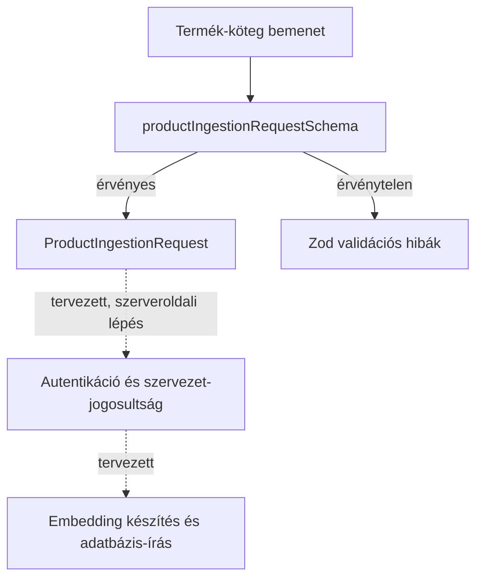

# Product ingestion — validálási alap

## Mire való ez a réteg?

A `lib/validations/product-ingestion.ts` Zod-sémái ellenőrzik a termékadatok és a kötegkérés alakját. Sikeres validáláskor Zod által következtetett TypeScript-típusok állnak rendelkezésre. A séma nem tartalmaz `organization_id` mezőt.

Ez a réteg **adatvalidálás**, nem jogosultság-ellenőrzés: megállapítja, hogy a bemenet megfelel-e a várt formátumnak, de nem azonosítja a felhasználót, és nem ellenőrzi, hogy hozzáfér-e egy szervezethez. A későbbi szerveroldali útvonal feladata lesz az autentikáció és a szervezet kiválasztása/engedélyezése.

## Fájlok felelőssége

- `lib/validations/product-ingestion.ts` — termék- és kötegkérési sémák, valamint az azokból származó `ProductInput` és `ProductIngestionRequest` típusok.
- `tests/validations/product-ingestion.test.mjs` — Node beépített tesztfuttatójával ellenőrzi az érvényes és hibás bemeneteket, a korlátokat és az alapértékeket.
- `docs/architecture/PRODUCT_INGESTION.md` — a validálási réteg hatókörét és későbbi helyét dokumentálja.

## Adatfolyam

Az ábra folytonos része a most megvalósított validálás. Szaggatott részek a későbbi integráció tervei, jelenleg nem implementált működés.

## Ellenőrzött szabályok

- `product_id`: 1–255 karakter.
- `product_name`: 2–500 karakter.
- `product_description`: 10–5000 karakter.
- `category`: opcionális, legfeljebb 100 karakter.
- `price`: opcionális, véges és nemnegatív szám.
- `currency`: opcionális, pontosan három nagybetű.
- `product_url` és `product_image_url`: opcionális, érvényes HTTP- vagy HTTPS-URL.
- `metadata`: opcionális objektum, amely JSON-értékeket tartalmazhat rekurzívan (szöveg, véges szám, logikai érték, null, tömb vagy objektum).
- `products`: 1–100 termék.
- `batch_size`: egész szám 1–20 között, alapértéke 10.
- `overwrite_existing`: logikai érték, alapértéke `false`.

Az adatbázis oszlopaihoz és hosszkorlátaihoz igazodó szabályok a projekt által megadott sémakontextuson alapulnak; az élő adatbázisban ezek még nincsenek ellenőrizve.

## Interview explanation

This validation layer checks product data before a future server endpoint uses it. It checks required fields, URLs, prices, and batch limits. It also gives TypeScript types from the same rules. Validation does not prove that a user is allowed to write to an organization. The server must check that separately. Database writes and API routes are not part of this change.
